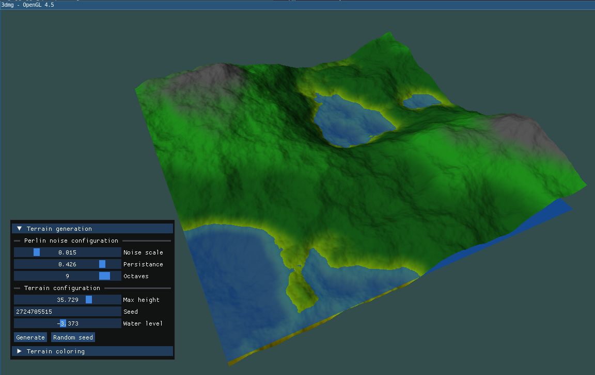
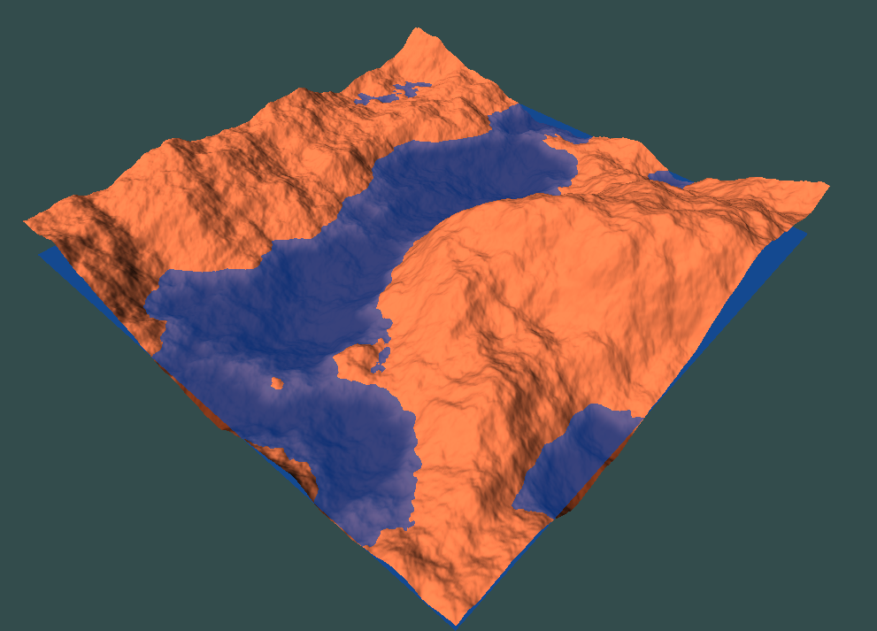

# 3dmg — 3D Map Generator

A real-time 3D terrain generator written in C++23, rendered with OpenGL 4.5. Terrain is procedurally generated using Perlin noise and can be customized interactively through an ImGui panel.

---

## Screenshots

| View 1 | View 2 |
|:------:|:------:|
|  |  |

---

## Features

- **Procedural terrain** via octave Perlin noise (configurable scale, persistence, octave count)
- **Real-time regeneration** — tweak parameters and re-generate terrain without restarting
- **Height-based coloring** — define up to 32 color layers with smooth blending at boundaries
- **Underwater shading** — terrain below the water plane darkens with a wet tint via `smoothstep`
- **Water plane** — a translucent quad rendered at a configurable height
- **Mouse-drag rotation** — left-click and drag to orbit the terrain around the Y axis
- **Seed control** — set a manual seed or generate a random one from the UI
- **ImGui panel** — all parameters are live-editable at runtime

---

## Tech Stack

| Library | Role |
|---------|------|
| **SDL3** | Window creation, OpenGL context, input events |
| **OpenGL 4.5 / GLAD** | Rendering API |
| **GLM 1.0.3** | Math (vectors, matrices, transforms) |
| **ImGui** | Immediate-mode debug/control UI |

**Language & standard:** C++23 (`std::print`, designated initialisers, ranges, …)
**Build system:** CMake ≥ 3.28

---

## Building

### Prerequisites

- A C++23-capable compiler (GCC 13+ or Clang 16+)
- CMake ≥ 3.28
- SDL3 installed and findable by CMake (`SDL3 CONFIG`)
- An internet connection for the first build (GLM is fetched via `FetchContent`)

### Steps

```bash
git clone <repo-url>
cd cpp-3dmg

cmake -B build -DCMAKE_BUILD_TYPE=Release
cmake --build build -j$(nproc)
```

The binary is placed in `build/` and must be run from the **project root** so the relative shader paths (`./shaders/`) resolve correctly:

```bash
./build/3dmg
```

---

## Runtime Controls

| Input | Action |
|-------|--------|
| Left-click + drag | Rotate terrain around Y axis |
| ImGui panel | Edit all terrain/noise/coloring parameters |

### UI Panel Parameters

| Parameter | Description |
|-----------|-------------|
| **Seed** | Noise seed; affects the random permutation table |
| **Generate seed** | Randomises the seed |
| **Perlin scale** | Frequency of the base noise wave |
| **Persistence** | Amplitude decay per octave |
| **Octaves** | Number of noise layers stacked |
| **Max height** | Height scale applied to the noise output |
| **Water height** | Y position of the water plane |
| **Color layers** | Add/remove height bands with custom colors |
| **Generate terrain** | Rebuilds the mesh with current settings |
| **Apply coloring** | Uploads the current color layers to the GPU |
